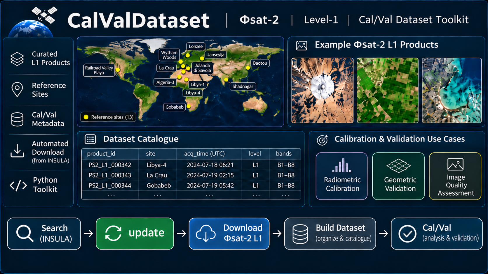

# CalValDataset — PhiSat-2 catalogues

This repository provides PhiSat-2 Level-1 **products' references and associated metadata**, organized into **geometry**, **image_quality** and **radiometry**. A reference identifies a product on Insula by its name, catalogue ID and acquisition dates. Associated metadata includes site coordinates, expected local band paths and any curated pixel regions of interest. The repository does not contain the satellite imagery itself.

**Phi-Down** is the Python client used to authenticate to Insula, search its catalogue for acquisitions covering the configured site coordinates, and resolve and download product archives. Updating the local catalogues means adding newly discovered references and refreshing metadata in JSON files. It does not download imagery, process pixels or publish changes back to Insula; imagery is downloaded separately on request.

## Repository contents

| File or directory | Detailed role |
|---|---|
| [geometry/geometry_dataset.json](geometry/geometry_dataset.json) | References for geometric calibration/validation: stable sessions, acquisition/site metadata, eight band destinations and optional pixel ROIs. |
| [image_quality/image_quality_dataset.json](image_quality/image_quality_dataset.json) | References for image-quality work, with the same schema. It describes available data rather than calculating MTF or SNR. |
| [radiometry/radiometry_dataset.json](radiometry/radiometry_dataset.json) | References for radiometric calibration/validation; it stores metadata and ROIs without applying radiometric corrections. |
| [dataset.py](dataset.py) | Shared offline data layer: validates/reads/writes JSON and site CSVs, merges released and personal sites, validates the Insula credential file, and discovers TIFF bands and their standard destinations. |
| [update_datasets.py](update_datasets.py) | Combines site lists, queries every candidate catalogue page through Phi-Down, verifies exact point-in-footprint coverage and adds/refreshes category entries. Preserves sessions and crops and produces the report; retrieves metadata only. |
| [download_and_organize.py](download_and_organize.py) | Reads and filters entries by category/site/session/product or selection JSON. Previews by default; with `--download`, resolves and downloads archives through Phi-Down. `--unzip` extracts and organizes eight bands. A shared ZIP cache avoids repeated downloads. |
| [sites_to_be_removed.csv](sites_to_be_removed.csv) | Manually rejected acquisition identifiers, skipped across all categories before downloads. |
| [sites.csv](sites.csv) | Released site names, coordinates, countries, stable codes and one or more categories. |
| [sites.personal.csv.example](sites.personal.csv.example) | Header-only template for a separate user-maintained site CSV, added to the released list. The real `sites.personal.csv` is local and Git-ignored. |
| [.s5cfg.example](.s5cfg.example) | Placeholder-only credential template. Enter your Insula username/password in a local `.s5cfg` before live searches or downloads. |
| [requirements.txt](requirements.txt) | Python dependencies, including Phi-Down, pandas and Shapely. |
| [examples/01_read_catalogues.py](examples/01_read_catalogues.py) | Offline executable example: prints selected product identifiers, acquisition dates and ROI counts. |
| [examples/02_download_products.py](examples/02_download_products.py) | Previews a sample session, or delegates selective/full downloads to the real downloader with `--download`. |
| [examples/03_update_datasets.py](examples/03_update_datasets.py) | Previews the merged site list, including personal additions, and calls the real updater only with `--run`. |
| [LICENSE](LICENSE) | Apache-2.0 license for the repository code. |

`reports/last_update.json` and `downloads/` are generated locally when needed and are excluded from Git.

Each category directory initially contains only its JSON catalogue. Site/session directories are created when products are downloaded. A cloned copy works independently of the previous dataset and migration scripts.

## Manually excluded acquisitions

`sites_to_be_removed.csv` records acquisitions manually rejected after visual inspection because of satellite acquisition problems. Despite its historical filename, it excludes **individual products, not entire sites**. The list currently contains **32 products**. Its columns preserve the site name, coordinates, country, location code, category and session for review; the full `Product` identifier is the exclusion key.

The downloader automatically removes these products from every selection before downloading or extracting imagery. This applies to the full dataset, category/site/session filters, explicit `--product` requests, custom `--json` selections, the runnable examples and direct calls to `download_entries`. An excluded acquisition is skipped in **all categories and sites**, even if its session label changes. The command reports how many category entries were skipped. If all selected products are excluded, it exits successfully without contacting Insula.

The exclusion list is always loaded from the code directory beside `dataset.py`, including when `--dataset-root` points to another output directory. A missing or malformed exclusion file stops the operation rather than silently allowing rejected products. To reject another acquisition, add a row with its exact full product name in `Product` (with or without `.zip`) and the associated site/session information. To reinstate an acquisition after review, remove its row. Keep the CSV header even when there are no exclusions.

Catalogue JSON files retain the original product references and session numbering. Updates from Insula can refresh these references, but the downloader continues to exclude rejected products while they remain in the CSV. Existing downloaded files are not deleted by this filter. All availability tables below exclude manually rejected acquisitions and show only products currently eligible for download.

For the current snapshot, applying the 32 rejected product identifiers leaves **89 unique products across 105 category entries** eligible for download. The exclusions remove 36 category entries because four rejected Baotou products also occur in radiometry.

Downloadable samples from the live Insula catalogue snapshot of 10 November 2026, after applying the manual exclusions reviewed on 11 November 2026:

| Category | Site/product entries | Entries with existing crops |
|---|---:|---:|
| geometry | 21 | 5 |
| image_quality | 18 | 2 |
| radiometry | 66 | 9 |
| Total | 105 | 16 |

The usable selection contains **89 unique products**. The 12 retained Baotou products belong to both image_quality and radiometry; the four Genoa products belong to both geometry and image_quality, accounting for 16 additional category entries. The six cross-talk candidate sites are assigned to radiometry; eight products remain eligible across CT01, CT02 and CT06. CT03, CT04 and CT05 currently have no retained products.

**Site/product entries** counts retained category/site/product associations after manual exclusions. Products assigned to two categories contribute one entry in each: 105 entries represent **89 unique acquisitions**.

**Entries with existing crops** counts retained entries with at least one saved pixel ROI in `bbox` (`x_min`, `y_min`, `x_max`, `y_max` and a label). These pixel regions are not geographic search footprints or pre-cropped files. `bbox: []` means no ROI has been defined; all eight bands remain available for eligible products. The 16 crop-bearing entries are included in the 105 total entries.

## Available products by site

Products eligible for download from the live Insula snapshot of **10 November 2026**, after the manual exclusions reviewed on **11 November 2026**. Each retained product is counted once per site, including products assigned to multiple categories. Zero means no retained products in this snapshot, including sites whose acquisitions were all rejected. Sites not yet queried are marked separately.

| Site | Code | Country | Categories | Available L1 products |
|---|---|---|---|---:|
| Railroad Valley Playa | RVUS | USA | radiometry | 3 |
| La Crau | LCFR | France | radiometry | 5 |
| Gobabeb | GHNA | Namibia | radiometry | 11 |
| Baotou | BAOT | China | image_quality, radiometry | 12 |
| Jarvselja | JAES | Estonia | geometry | 2 |
| Jolanda di Savoia | JSIT | Italy | radiometry | 0 |
| Lonzee | LOBE | Belgium | radiometry | 0 |
| Wytham Woods | WWUK | UK | geometry | 1 |
| Princess Elisabeth | PEAN | Antarctica | radiometry | 3 |
| Libya-4 | LYB4 | Libya | radiometry | 5 |
| Libya-1 | LYB1 | Libya | radiometry | 6 |
| Algeria-3 | ALG3 | Algeria | radiometry | 5 |
| Shadnagar | SHAD | India | radiometry | 8 |
| Piedmont | PIED | Italy | geometry | 1 |
| Grosseto | GROS | Italy | geometry | 1 |
| Pueblo Range | PRING | USA | geometry | 6 |
| Sioux Falls Range | SFRG | USA | geometry | 6 |
| King Fahd Causeway | KFCS | Saudi Arabia/Bahrain | image_quality | 1 |
| San Mateo Bridge | SMBR | USA | image_quality | 1 |
| Haiwan Bridge | HWBR | China | image_quality | 0 |
| Lake Pontchartrain Causeway | LPCW | USA | image_quality | 0 |
| Genoa | GENO | Italy | geometry, image_quality | 4 |
| Atlantic Open Ocean | CT01 | International waters | radiometry | 1 |
| South Pacific Open Ocean | CT02 | International waters | radiometry | 4 |
| Amazon Rainforest | CT03 | Brazil | radiometry | 0 |
| Central Borneo Rainforest | CT04 | Indonesia | radiometry | 0 |
| Greenland Inland Ice | CT05 | Greenland | radiometry | 0 |
| Antarctica Dome C Region | CT06 | Antarctica | radiometry | 3 |
| Honolulu | URB01 | USA | radiometry | Not catalogued |
| Indian Ocean Open Water | CT07 | International waters | radiometry | Not catalogued |
| **Total unique products eligible for download** | | | | **89** |

The 28 snapshot sites were checked on Insula on 10 November 2026 without search errors. After exclusions, Genoa contributes four products and the six cross-talk sites contribute eight products. Eligibility means the product is present in the snapshot and is not on the manual rejection list; suitability for a specific analysis still depends on the application.

The released site list now contains 30 sites. Honolulu (URB01) and Indian Ocean Open Water (CT07) were added as radiometry reference points on 11 November 2026; their acquisitions have not been added to this catalogue snapshot. The site CSV stores coordinates and categories, so its updater can return both daytime and nighttime acquisitions. Adding these points does not apply a nighttime-only filter. The inspected Honolulu candidate remains unvalidated as an urban-night target because its TIFF geolocation differs from the catalogue footprint.


Run `python update_datasets.py` to check for newer acquisitions; this table documents the dated snapshot above.

## Installation and Insula credentials

Use Python 3.11 or later. From the repository root on Windows:

```powershell
py -3.12 -m venv .venv
.\.venv\Scripts\python.exe -m pip install -r requirements.txt

# Run this only if you do not already have a configured .s5cfg file.
Copy-Item .s5cfg.example .s5cfg
```

**You must enter your own Insula username and password in the local `.s5cfg` file before downloading products or querying Insula.** Place the file in the repository root and fill in the `[phisat2]` section:

```ini
[phisat2]
username = YOUR_INSULA_USERNAME
password = YOUR_INSULA_PASSWORD
```

Replace the placeholders with your actual Insula credentials. Preserve any existing configuration settings. The local `.s5cfg` file is excluded from Git and must not be committed or shared. Catalogue previews do not require credentials.

The commands below use `python`: activate your virtual environment or replace it with `.\.venv\Scripts\python.exe`. On Linux/macOS, use the corresponding virtual environment interpreter. Both main scripts accept `--config` to use a credential file at another path.

## Read catalogues and select products

Every catalogue contains an `entries` list. Each entry provides `category`, `location`, `session`, `directory`, `bands`, `bbox` and `metadata`. The complete product identifier is stored in `metadata.session_id`; metadata also includes the catalogue ID, site coordinates and acquisition timestamps in UTC.

Read a JSON file directly:

```python
import json
from pathlib import Path

path = Path("radiometry/radiometry_dataset.json")
entries = json.loads(path.read_text(encoding="utf-8"))["entries"]
for entry in entries:
    print(entry["location"], entry["session"], entry["metadata"]["session_id"])
```

Without `--download`, the downloader only displays the selection:

```powershell
# Preview all products.
python download_and_organize.py

# Filter by category, site code or session.
python download_and_organize.py --category radiometry
python download_and_organize.py --location LCFR
python download_and_organize.py --category image_quality --location BAOT --session Session1

# Read products from a particular JSON catalogue.
python download_and_organize.py --json radiometry/radiometry_dataset.json
```

## Download products

Add `--download` to download the selection. Add `--unzip` to extract ZIP archives and organize the TIFF bands at the standard local paths already declared in the JSON:

```powershell
# Download and extract the entire dataset.
python download_and_organize.py --download --unzip

# Download one session.
python download_and_organize.py --category image_quality --location BAOT --session Session1 --download --unzip

# Download all products from one JSON catalogue.
python download_and_organize.py --json radiometry/radiometry_dataset.json --download

# Select an exact product name; repeat --product to select multiple products.
python download_and_organize.py --product PHISAT-2_L1_000001340_20241007034054_20241007034103_E04D392C --download
```

For a custom selection, copy the desired entries into a separate JSON file under `entries` and pass `--json selection.json`. If band paths are indexed, only that supplied JSON file is updated; the complete catalogues are preserved.

Products are organized under `category/site_code/SessionN/`. A shared local `downloads/` cache avoids downloading the same product twice when it belongs to multiple categories. Each destination receives its own copy, and ZIP archives are retained. The downloader resolves the exact product name through the platform-files API because catalogue UUIDs may differ from downloadable file IDs.

## Released and personal reference sites

Keep [sites.csv](sites.csv) as the released list. Copy the personal template once and add your own rows to the copy:

```powershell
Copy-Item sites.personal.csv.example sites.personal.csv
```

```csv
Site,Latitude,Longitude,Country,Location,Categories
My reference site,45.123,9.456,Italy,MY01,radiometry
Another personal site,44.123,10.456,Italy,MY02,geometry;image_quality
```

These coordinates illustrate the format; enter your actual site coordinates. The updater automatically adds `sites.personal.csv` beside the base list if it exists. To use another file:

```powershell
python update_datasets.py --personal-sites ../private-sites.csv
python update_datasets.py --personal-sites ../private-sites.csv --only MY01
python examples/03_update_datasets.py --personal-sites ../private-sites.csv
```

The effective list contains released sites plus personal sites. A personal row for an existing code takes precedence for its name, coordinates and categories without changing the code's canonical spelling or existing session identifiers. Names shared by different codes cause an explicit conflict rather than silently dropping a site. A header-only personal CSV is valid; an explicitly requested missing file is an error.

Neither CSV is written by a search or catalogue update. The personal CSV is Git-ignored, so updating the released site list does not overwrite your selections. Personal acquisitions are added to the local category JSONs; review those JSONs before committing if the additional site information should remain private. `--sites` intentionally chooses an alternative **base** list; use `--personal-sites` to **add** to the released list.

Keep site codes stable when changing coordinates. Categories are `geometry`, `image_quality` and `radiometry`, separated by `;` for multiple categories. Coordinates are reference points in EPSG:4326, with west and south negative, rather than area polygons.

## Update the dataset from Insula

```powershell
# Search every configured site, update the catalogues and write a report.
python update_datasets.py

# Search one site by name or location code.
python update_datasets.py --only "La Crau"
python update_datasets.py --only LCFR
```

The update command:

1. Merges the released and personal site lists, then reads the existing JSON catalogues.
2. Retrieves all candidate pages of Level-1 products from Insula.
3. Keeps only products whose footprints cover the exact site point, including the boundary, with no buffer in the final check.
4. Adds new acquisitions to the configured categories without duplicates or empty session directories.
5. Refreshes available catalogue metadata while preserving existing crops, band paths and session identifiers.
6. Prints a short summary and saves `reports/last_update.json`.

Run the command after adding or editing sites, or whenever you want to check existing sites for new acquisitions. Updates happen automatically during command execution. Periodic execution can be scheduled separately if needed.

The report records `UPDATED`, `NO_UPDATES`, `PARTIAL_ERROR` or `ERROR`, together with new unique products, category entries added, metadata changes, site-list changes and the result for each checked site. The first run establishes the site-list baseline; subsequent runs compare against the previous report. The report is replaced on each run. Use `--report path.json` to choose another location.

Zero matching products are distinguished from a failed search. Errors preserve existing data and do not block the other sites. Previously catalogued products that are no longer returned by Insula are retained and listed in `previous_products_not_returned`. Removing a site or category from the configuration stops future searches for it without deleting existing catalogue entries.

New sessions are appended after existing sessions, including acquisitions with earlier dates. `SessionN` is a stable identifier rather than a chronological ranking.

## Crop and band metadata

All **16 original crops** retain their pixel coordinates and labels in `bbox`. Unanalysed products have `"bbox": []`. Downloads do not depend on crop values, so an undefined crop does not block the workflow.

To record a measured region of interest, edit only the matching entry's `bbox`. This example illustrates the format; replace its coordinates with values verified on the actual image:

```json
"bbox": [
  {"x_min": 100, "y_min": 200, "x_max": 300, "y_max": 400, "label": "Measured ROI"}
]
```

Every product has one `bands` mapping with keys `b_0` through `b_7`, whether or not a crop is defined. Paths are declared in advance as `category/site_code/SessionN/bands/b_0.tiff` through `b_7.tiff`, so they do not depend on the original filenames or an available bbox. These are expected local destinations; files become available after running the downloader with `--download --unzip`. The redundant `legacy_bands` mapping has been removed.

After extraction, the downloader identifies the original TIFFs and creates the standard band files while preserving the extracted package and original ZIP. It uses hard links where supported and copies otherwise. Missing or ambiguous bands produce an explicit error. Standardization changes local filenames only, preserving raster contents and crop coordinates.

The project stores crop definitions and does not perform image cropping or image-quality analysis. Every product has a numeric `metadata.resolution` value of `4.75`, expressed in metres, matching the nominal PhiSat-2 resolution used by this dataset. New acquisitions receive the same value. Original TIFF filenames and raster dimensions are not guessed. Updates never transfer a crop to another acquisition. Historical information is retained in the existing product metadata; numeric latitude/longitude values refer to the current search coordinates.

## Runnable examples

The former unit-test folder has been replaced by [examples](examples/README.md), containing practical scripts that call the actual workflow code:

```powershell
# Read local catalogues and display selected metadata.
python examples/01_read_catalogues.py --category radiometry --location LYB1

# Preview the default sample session, then download it if desired.
python examples/02_download_products.py
python examples/02_download_products.py --download --unzip

# Download the complete dataset.
python examples/02_download_products.py --all --download --unzip

# Preview configured sites, then run a live update if desired.
python examples/03_update_datasets.py
python examples/03_update_datasets.py --only LCFR --run
python examples/03_update_datasets.py --run
```

Reading and previewing work without credentials. Actual downloads and live updates require the Insula credentials configured in `.s5cfg`. The examples use the main modules directly and are intended as executable usage guides rather than an automated test suite.


## Contributing

Contributions are welcome, including suggestions for new calibration and validation sites. Please:

1. Fork the repository.
2. Create a feature branch.
3. Add tests and documentation updates where relevant, and keep the runnable examples consistent with any interface changes.
4. Open a pull request with a clear description of the proposed change and its validation.

To propose a new released site, include its name, country, unique location code, latitude/longitude in EPSG:4326, relevant categories (`geometry`, `image_quality`, `radiometry`) and a short explanation of its calibration/validation value. Add the row to the released `sites.csv` (under `src/calvaldataset/data/` in the package branch). Include product identifiers or verified crop information when available; leave unanalysed crops empty rather than inventing coordinates.

For sites intended only for your own workflow, use the separate personal-site CSV described above instead of changing the released list.

For bugs, questions and new site suggestions, use:

- Issues: [CalValDataset issues](https://github.com/lorenzopapa5/CalValDataset/issues).

## Citation

Citation details will be provided in a future release. The following entry is a placeholder:

```bibtex
@misc{VHRODA2026,
}
```

## License

This project is licensed under the Apache License 2.0. See [LICENSE](LICENSE) for details.
